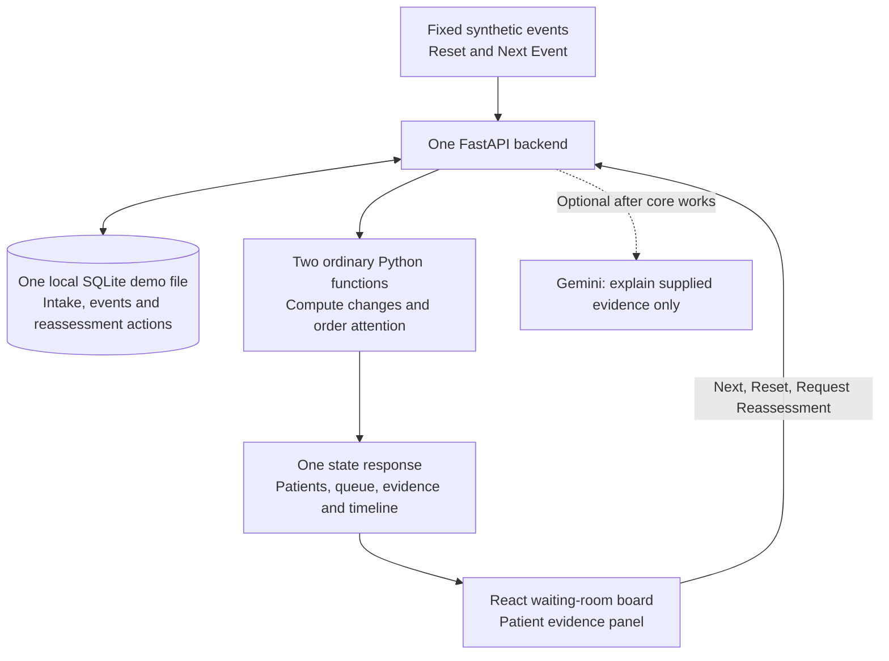

# Atria

## Two-Hour MVP: ER Waiting Room Reassessment

**Who in the waiting room may need reassessment next, and why?**

This replaces the larger team plan for the remaining two-hour build. It is a **plan**, not a claim that these features are implemented. Keep the existing repository and working foundation; do not attempt a rewrite.

## 1. What We Will Build

One local demo with **four synthetic patients**, one backend and one operational screen:

1. Show intake context, current measurements, waiting time and attention position.
2. Click **Next Event** to advance a fixed patient-event sequence.
3. Bay 4 changes and moves above Bay 7 in a separate reassessment Attention Queue.
4. Select Bay 4 to see intake/current/delta, a short event timeline and the ordering reason.
5. Click **Request Nurse Reassessment** and show a recorded confirmation.
6. Click **Reset Demo** and repeat the same story.

The board is the main interface. An evidence explanation generated from actual values is required; an AI-generated explanation is optional.

## 2. Reduced Architecture



Use the existing FastAPI/React patterns. SQLite is the default for this local synthetic MVP: no new hosted database, migration project, worker system or realtime messaging setup. Do not connect the demo to valued existing data. A single dedicated demo file stores events and actions; reset affects only that file's demo run.

The frontend fetches the same backend state after each action and polls every two seconds if needed. It does not maintain an independent patient simulation.

### No separate agent infrastructure in this build

Keep the responsibilities as two functions inside one backend:

- `compute_changes`: latest values, intake deltas, recent sequence and a plain-language evidence reason.
- `build_attention_queue`: transparent prototype ordering with a reason for each changed position.

No separate Vital/Trend/Context agents, Patient Coordinator, Waiting Room Coordinator processes, consensus system, broker or model service. Do not market these two functions as multiple autonomous agents. Those are future architecture options.

## 3. Four-Patient Demo

| Patient | Synthetic intake context | Role |
|---|---|---|
| Bay 7 | Higher intake label, illustrative ESI 2; explicit existing demo review request | Comparatively unchanged; retains its original label and remains visible |
| Bay 4 | Lower intake label, illustrative ESI 3; HR92, SpO₂98%, pain4 | Main changing trajectory |
| Bay 9 | Illustrative ESI 4; longest wait | Unchanged; waiting alone does not create the strongest signal |
| Bay 2 | Illustrative ESI 3; HR84, SpO₂98%, pain3 | One temporary anomaly followed by recovery |

ESI labels are fictional intake inputs, not calculated or validated by Atria. No real waiting policy or appropriate clinical disposition is implied.

### Fixed event batches

Every Next Event commits one predefined batch, then returns the updated state. The values below are the one agreed fixture, not random events.

| State | Bay 4 | Bay 2 | Expected attention order |
|---|---|---|---|
| Reset, 10:02 | HR92 / SpO₂98 / pain4 | HR84 / SpO₂98 / pain3 | 7, 9, 2, 4 |
| Next 1, 10:18 | HR101 / SpO₂96 / pain5 | One HR106 / SpO₂94 sample | 7, 2, 4, 9 |
| Next 2, 10:25 | HR110 / SpO₂94 / pain6 | Recovery to84 /98 /3 | 4, 7, 9, 2 |
| Next 3, 10:36 | HR121 / SpO₂91 / pain7; new synthetic worsening-symptom report | Unchanged after recovery | 4, 7, 9, 2 |

Stable patients receive explicit unchanged observations in each batch. Use fixed UTC arrival/event times and derive waiting time from the replay clock. Bay 9 has the earliest arrival; Bay 2 arrived before Bay 4.

### Minimal prototype policy

This rule exists only to make the synthetic demonstration transparent and repeatable. It is **not clinically validated**.

- Persistent-change tier: the last three paired observations have strictly rising HR and falling SpO₂. Bay 4 qualifies at Next 2.
- Existing human-review-request tier: Bay 7 begins with an explicit synthetic request; Atria does not clear it.
- Watch-change tier: latest HR is above intake and SpO₂ is below intake, without persistence. Bay 2 and Bay 4 qualify at Next 1.
- Unchanged tier: no qualifying current change. Within each tier, longer waiting time is the tie-breaker; use a stable patient ID for any remaining tie.

Pain/symptom changes support the explanation; no probability is calculated. Missing observations return unknown/insufficient evidence, not normal. Recovery can remove a computed watch finding, but it must not invent a nurse action or close an existing human request.

This is a separate **attention view**, never the official clinical queue. Bay 7's higher intake label stays visible even when Bay 4 leads this list.

## 4. Minimal UI

One board plus a side panel. No navigation system, map, elaborate chart library or chatbot-first screen.

**Header:** ATRIA · Emergency Department · SYNTHETIC DEMO

**Columns:** Attention, Bay, Intake, Current HR/SpO₂/Pain, Waiting, Trajectory.

**Controls:** Reset Demo and Next Event. Automatic playback, Pause and speed settings are stretch goals, not core requirements.

Selecting a patient shows:

| Bay 4 measurement | Intake | Final | Delta |
|---|---:|---:|---:|
| HR | 92 bpm | 121 bpm | +29 bpm |
| SpO₂ | 98% | 91% | −7 percentage points |
| Pain | 4/10 | 7/10 | +3 |

Also show a compact timestamped event list, the ordering reason and **Request Nurse Reassessment**. Display confirmation only after the backend records the action. Keep the visible synthetic label and use text alongside color.

Do not add separate acknowledge/resolve/access-audit workflows in the two-hour build. The required audit is the explicit reassessment request: action ID, demo actor, patient/run, state version, timestamp and reason. Disable duplicate requests for the same run/patient/signal version, and retain them in the demo file until explicit reset.

## 5. Two-Person Split

### Person 1 — Atishay: Backend and Demo Intelligence

Own only:

- Four intake fixtures and the three fixed event batches.
- Dedicated local demo API and SQLite event/action storage.
- Reset/Next controls, fixed replay clock and one authoritative state.
- Intake deltas, the documented prototype ordering and evidence reason.
- Reassessment-request persistence and duplicate protection.
- Focused scenario/reset/action tests.

Reuse source helpers where useful. Do not start legacy bed, discharge, cleaning or real-call workflows from the new demo entry point. Preserve their source without integrating them into this build.

**Deliverable:** the frontend can consume one state response and reproduce the queue table above.

### Person 2 — Other Developer / Team: Board and Evidence Experience

Own only:

- Four-row waiting-room board.
- Reset/Next buttons connected to the backend.
- Patient side panel with intake/current/delta and a simple timeline.
- Queue movement and clear evidence reason, without decorative animation.
- Request Reassessment button and confirmed/error states.
- Synthetic labels, demo rehearsal and backup video.

**Optional, after the connected demo works:** one “Explain Bay 4 vs Bay 7” button using Gemini. Send the actual evidence snapshot; no free-form chatbot, tool framework, document upload or extra conversational routes.

**Deliverable:** a judge understands why Bay 4 moved and sees a human request recorded.

## 6. Agree This API in the First Ten Minutes

These are proposed endpoints, not currently available routes.

| Endpoint | Behavior |
|---|---|
| `GET /api/demo/state` | One consistent response: run/version/replay time, all patients, ordered IDs, selected evidence, timelines and action states |
| `POST /api/demo/reset` | Reset only this disposable demo run and return state |
| `POST /api/demo/next` | Atomically apply the next batch; after batch3 return completed without replaying it |
| `POST /api/demo/reassessment` | Record a request for patient/run/version; return confirmation/action ID or an explicit error |

Minimal state shape:

```json
{
  "run_id": "demo-run-1",
  "version": 3,
  "replay_time": "2026-10-19T10:36:00Z",
  "demo": true,
  "ordered_patient_ids": ["bay4", "bay7", "bay9", "bay2"],
  "patients": [
    {
      "patient_id": "bay4",
      "bay": "Bay 4",
      "initial_triage": 3,
      "intake": {"hr": 92, "spo2": 98, "pain": 4},
      "current": {"hr": 121, "spo2": 91, "pain": 7},
      "delta": {"hr": 29, "spo2_pp": -7, "pain": 3},
      "trajectory": "persistent_change",
      "reason": "HR rose across three observations while SpO2 fell; pain increased since intake.",
      "timeline": [],
      "reassessment_requested": false
    }
  ]
}
```

The shortened example contains one patient; real state responses must contain all four and their actual timestamped timelines. The frontend renders backend order/reasons; it does not implement a second ordering policy. Requests carry run/version so stale actions fail explicitly.

## 7. Two-Hour Schedule

| Time | Person 1 | Person 2 |
|---|---|---|
| 0–10 min | Together agree payloads, fixture order and endpoint names | Same; build against one labeled sample response |
| 10–35 min | Intake/events, local store, state/reset/next endpoints | Board and side panel using the agreed shape |
| 35–60 min | Deltas, ordering and real timelines; hand over working API | Connect API; verify actual queue movement |
| 60–80 min | Persist reassessment request; reset/idempotency tests | Request confirmation/errors and readable evidence |
| 80–100 min | Fix integration problems; verify fixture and missing-data behavior | Polish connected flow; optional Gemini button only if core already passes |
| 100–120 min | Both stop adding features, run demo twice and fix blockers | Rehearse, record backup video, verify recovery/reset |

**Minute60 checkpoint:** the real backend must move Bay 4 in the board. If not, both focus on that. Do not start sponsor work while the core flow is disconnected.

## 8. What We Are Deferring

| Deferred item | Why |
|---|---|
| Separate monitoring agents, coordinators and consensus | Unnecessary orchestration for four patients and three event batches |
| Tiger Data integration and advanced rolling/acceleration queries | Hosted setup/migration can consume the deadline; local history supports this prototype, without a Tiger claim |
| Full Ask Atria chat and multimodal inputs | One grounded explanation is enough; Gemini button is optional |
| Open model, confidence display and model evaluation | Cannot validate or integrate responsibly inside this deadline |
| Raleigh map/community intelligence | Not required to demonstrate reassessment |
| DigitalOcean deployment and Sentry tracing | Use a working local demo rather than spending the core build on new infrastructure |
| Snowflake historical analytics | No meaningful historical dataset yet |
| Eight-patient expansion, extra review workflows and elaborate charts | Four patient roles and one human action prove the central story |

These integrations remain future work, not completed features or prize qualifications. Existing source integrations are preserved, but they are not requirements for the reduced demo. Do not claim a distributed multi-agent system or seven sponsor integrations from this implementation.

## 9. Acceptance Checks and Three-Minute Demo

Required checks:

- Reset restores four intakes and order7,9,2,4.
- Next1 shows temporary changes; Next2 recovers Bay2 and moves Bay4 first; Next3 shows +29/−7/+3.
- Repeating the sequence produces the same observations/order; extra Next clicks do not duplicate events.
- Bay7's original intake label never changes; Bay9's longer wait does not put it above persistent change.
- A failed request shows an error, never success; a duplicate request creates no duplicate action.
- Data is backend-owned and visibly synthetic; no real call, bed assignment or treatment occurs.

Demo: show four patients → compare Bay7/Bay4 intake → click Next three times → show Bay4 moving upward → open its intake/current/delta and event list → explain why → request reassessment and show confirmation → reset. If the optional Gemini button is absent, use the real deterministic evidence reason without claiming an AI response.

**Definition of done:** the complete local flow works twice and can be explained in three minutes. Everything else is deferred.

## Database Setup — Current Progress

The local synthetic database layer is implemented in `atria/db.py`, with four intakes, fixed event batches, per-field measurement timestamps, request deduplication, immutable intake and archived runs. No queue API or attention ordering is implemented by this database layer.

```sh
python3 -m scripts.er_db init
python3 -m scripts.er_db status
python3 -m scripts.er_db next
python3 -m scripts.er_db reset
python3 -m unittest discover -s tests -p 'test_er_db.py' -v
```

Default local file: `var/atria-demo.sqlite3`, ignored by Git. `init` preserves an existing run; `reset` creates a new active run and retains previous history. No external credentials or legacy agents are used.

Supabase option: run `supabase/migration_er_mvp.sql` in the project SQL Editor. It adds only `er_demo_runs`, `er_encounters`, `er_patient_events`, `er_reassessment_requests`, their policies/indexes/triggers and Realtime membership. Expected seeded counts: 1 run, 4 encounters, 4 intake events and 1 explicit synthetic fixture review request for Bay 7. Rerunning does not reset existing runs.

The publishable client key permits reads of the active synthetic run, not table creation, resets or reassessment writes. Those writes need an authorized backend; no privileged write RPC is exposed. Local public connection settings are in ignored `.env.local`, and the existing legacy frontend is not switched to this project automatically. The hosted migration is prepared but has NOT been applied or verified on the project. A local PostgreSQL execution attempt was blocked by sandbox socket permissions; SQLite tests do not prove PostgreSQL/RLS behavior.

## 10. Safety

Atria is a hackathon prototype using synthetic patient data. It is not a medical device or validated clinical system. It does not diagnose, prescribe, autonomously change official triage/ESI, assign beds or determine treatment order. It provides evidence for human reassessment.

No clinical probabilities, efficacy, outcome-improvement or HIPAA-compliance claims. This local demo is not a production service. Source upload/deployment rights and sponsor eligibility remain separate unresolved matters; this plan does not clear them.

**Atria doesn't replace triage. It watches what happens after triage.**
