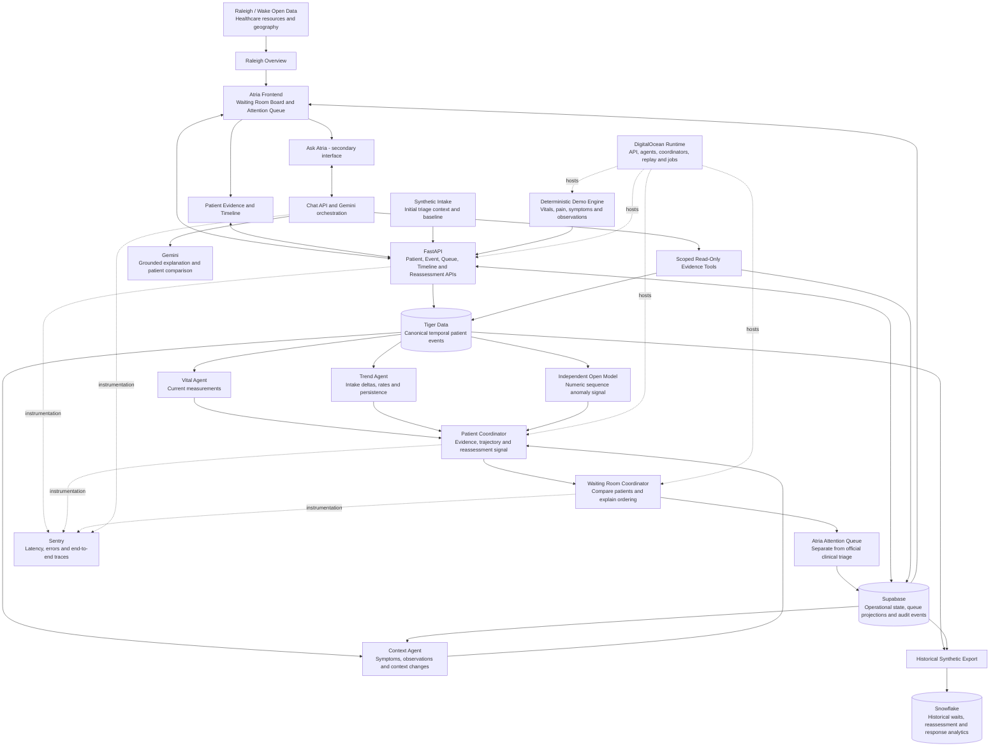

# Atria

## Continuous ER Reassessment Intelligence

### System Architecture and Two-Person Development Plan

**See what changed while patients wait.**

This is a proposed architecture and ownership plan. It does not claim that these features or sponsor integrations are implemented.

## 1. Product

Atria is a realtime decision-support system for emergency department waiting rooms. Initial triage captures a patient's condition on arrival; measurements, pain, symptoms and observations can change while they wait.

Atria asks:

> **Who in the waiting room may need to be reassessed next, and why?**

Atria surfaces changes, evidence and a separate **Attention Queue**. A nurse decides whether reassessment or escalation is appropriate. This queue does not replace the hospital's official triage queue or determine treatment order.

All hackathon patient information is synthetic.

## 2. Initial Severity, Current State and Trajectory

These remain separate concepts:

| Concept | Meaning |
|---|---|
| Initial severity | Human-entered triage context at intake; Atria does not automatically change it |
| Current state | Latest available measurements, symptoms and observations |
| Trajectory | Direction, persistence and magnitude of change since intake |
| Waiting time | Visible operational context; not the sole reason for clinical attention |

The primary demo contrasts two synthetic patients:

| Patient | Intake context | Current trajectory |
|---|---|---|
| Bay 7 | Higher initial severity, illustrative ESI 2 | Comparatively unchanged in available observations |
| Bay 4 | Lower initial severity, illustrative ESI 3 | HR 92 → 101 → 110 → 121; SpO₂ 98 → 96 → 94 → 91%; pain 4 → 5 → 6 → 7 |

Bay 4 rises in the reassessment Attention Queue as evidence changes. Bay 7's intake label remains unchanged and visible. Fictional ESI labels and demo ordering are not validated clinical assignments or recommendations about real waiting-room care.

## 3. System Architecture

The diagram describes planned responsibilities. Agent assessments can run in parallel; they are not a mandatory serial chain of AI calls.



### Data and service boundaries

| Technology | Responsibility |
|---|---|
| Tiger Data | Live temporal history: vitals, pain, symptoms, observations, rolling windows and change since intake |
| Supabase | Intake/encounter context, operational projections, human audit events and realtime UI updates |
| Gemini | Explain retrieved evidence, compare patients and answer Ask Atria questions; no fundamental temporal calculation or action authority |
| Independent open model | Separate numeric anomaly/sequence signal; not another LLM added solely for eligibility |
| DigitalOcean | Run meaningful API, worker, coordinator and simulation services |
| Sentry | Trace actual events, queries, model calls, coordination, queue updates and dashboard delivery |
| Snowflake | Historical and aggregate synthetic ER analytics; not a second live queue database |
| Raleigh / Wake data | Actual public resource/geographic context, clearly separated from simulated patients and waits |

Gemini reads structured evidence and queue versions through authorized tools. It does not invent patient facts, change intake triage, prescribe treatment or execute nurse actions.

## 4. Patient Intelligence Responsibilities

| Component | Question | Output |
|---|---|---|
| Vital Agent | What is happening now? Which current measurements are notable? | Current values, measurement changes and provenance |
| Trend Agent | What changed, when, how quickly and how persistently? | Intake deltas, recent deltas, rolling averages, rates, persistence and available anomaly windows |
| Context Agent | What changed in the patient's reported context? | Source-linked chief complaint, symptom, pain-report and observation changes; waiting context |
| Independent model service | Does a separate numeric method identify an unusual sequence? | Actual inference result, method/version and limitations, or unavailable/insufficient-data status |
| Patient Coordinator | What evidence supports human review for this patient? | Current state, intake changes, trajectory, agreement/disagreement and reassessment signal |
| Waiting Room Coordinator | Who may need reassessment next, and why? | Versioned Attention Queue, ordering reasons and visible initial-severity context |

Trend owns numeric pain trajectory; Context owns the content and provenance of pain/symptom reports. The open model is a service/module rather than an autonomous agent with clinical authority.

No unsupported clinical probabilities or synthetic confidence percentages. If evidence conflicts, show **LOW CONSENSUS — evidence is mixed; human review recommended**. Missing methods remain unavailable, not reassuring votes.

## 5. Primary Product Experience

### Waiting Room Board

The board leads with **ATRIA · Emergency Department · Live Waiting Room · SYNTHETIC DEMO**.

Columns: Attention, Patient/Bay, Intake, Current State, Waiting, Trajectory and Last Change. Use text/icons and hierarchy alongside color. Ask Atria is secondary to the operational board.

### Patient Evidence

Selecting Bay 4 shows:

| Measurement | Intake | Current | Change |
|---|---:|---:|---:|
| Heart rate | 92 bpm | 121 bpm | +29 bpm |
| SpO₂ | 98% | 91% | −7 percentage points |
| Reported pain | 4/10 | 7/10 | +3 |

Show raw trend points, timeline, agent findings, disagreement, evidence timestamps and missingness. These values are the planned synthetic demo example, not current application output.

Actions: **Review Evidence**, **Open Timeline**, **Acknowledge Signal**, **Request Nurse Reassessment**, **Resolve Signal**. Every explicit action generates an audit event. Acknowledge is not completed reassessment; resolve does not mean medical clearance. Confirm writes before showing success.

### Timeline

Illustrative event sequence: intake at 10:02; HR96/SpO₂97 at 10:10; HR101/SpO₂96/pain5 at 10:18; HR110/SpO₂94/pain6 at 10:25; worsening-symptom report at 10:31; HR121/SpO₂91/pain7 and reassessment signal at 10:36. Nurse acknowledgment/request appear only after actual human clicks, not prerecorded events.

### Ask Atria

- Who should be reassessed next?
- What changed with Bay 4?
- Why did Bay 4 move above Bay 7?
- Who changed most since intake?
- What happened during the last 20 minutes?
- Has anyone with lower initial severity started changing?

An answer should cite actual measurement values, source times and queue version. Bay 4's changing trajectory and Bay 7's higher initial label must remain distinct. No diagnosis or treatment recommendation.

## 6. Two-Person Ownership Split

Divide by system responsibility, not simply frontend versus backend.

### Person 1 — Atishay Kasliwal: Core Atria Intelligence

Own the pipeline from patient events to an explainable Attention Queue:

- Synthetic encounter/intake model and approximately eight demo patients.
- Deterministic simulation: Reset, Start, Pause, Next Event; optional 1x/2x/5x controls.
- Validated event ingestion, stable identifiers, timestamps and idempotency.
- Tiger Data event persistence and temporal queries.
- Intake deltas, rolling windows, rates and persistent-versus-transient change.
- Vital, Trend and Context components.
- Patient Coordinator and Waiting Room Coordinator.
- Attention ordering with initial severity, trajectory and waiting displayed separately.
- Patient/evidence/queue/timeline APIs.
- Backend reassessment workflow, durable audit and Supabase synchronization.
- Core tests and deterministic scenario acceptance.

**Success condition:** Bay 4 predictably rises above Bay 7 in the separate Attention Queue as its persistent change develops. Intake labels and the official clinical queue remain unchanged. The UI receives real backend events rather than an independent frontend animation.

**Secondary work:** independent open model, evaluation and coordinator disagreement, only after core ordering works.

### Person 2 — Other Developer / Team: Product Experience and Grounded AI

Own the experience judges see, inspect and ask questions about:

- Dense ER waiting-room board, patient rows and queue movement.
- Intake label, waiting time, current values, trajectory and freshness display.
- Patient detail, intake/current comparison, charts and timeline.
- Agent evidence and agreement/disagreement panels.
- Reassessment UI and confirmation against Person 1's action API.
- Ask Atria UI, Gemini orchestration, prompts, scoped tools and grounding tests.
- Patient comparison and evidence explanations.
- Raleigh resource overview/map with attribution and synthetic transition.
- Sentry integration and actual trace demonstration.
- DigitalOcean deployment, architecture presentation and demo polish.
- Demo script, rehearsal, screenshots and failure-recovery presentation.

**Success condition:** “Why did Bay 4 move above Bay 7?” receives a concise answer grounded in actual patient evidence and the displayed queue version.

**Secondary work:** Snowflake historical analytics, only after the board and grounded Gemini flow work.

### Shared boundaries

Person 1 owns source events, temporal calculations, queue policy and persisted clinical-context projections. Person 2 owns presentation and Gemini explanation, not a second queue policy or a frontend-only event stream.

Person 2 owns deployment/tracing integration; Person 1 supplies worker health, trace propagation and stable event/version identifiers. Each developer tests their boundary and reviews shared API changes before merging. No external service should silently replace another team's authoritative data.

## 7. Shared API Contract — Agree Before Implementation

The following are proposed boundary examples, not implemented endpoints. Agree the field names and versioning first so both people can work independently. IDs identify encounters, not reusable physical bays. Use UTC timestamps and an explicit run/as-of context; waiting time must agree with arrival.

```json
{
  "patient_id": "demo-patient-b",
  "encounter_id": "demo-encounter-b",
  "run_id": "demo-run-1",
  "bay": "Bay 4",
  "arrival_time": "2026-10-19T10:02:00Z",
  "as_of": "2026-10-19T10:36:00Z",
  "initial_triage": 3,
  "chief_complaint": "Synthetic demo complaint",
  "waiting_minutes": 34,
  "attention_position": 1,
  "trajectory": "persistent_change",
  "reassessment_signal": true,
  "demo": true
}
```

| Interface | Required contents |
|---|---|
| Patient event | event_id, run_id, encounter_id, observed/received time, event type, sparse measurements or report, quality and demo flag |
| Patient evidence | intake/current source references, numeric deltas with units, trajectory/window, agent findings/status, reassessment signal, reason and limitations |
| Attention Queue | run_id, queue_version, as_of, policy_version, complete ordered patients, position/previous_position and evidence-backed reason |
| Timeline | Typed intake/measurement/report/assessment/human events with stable IDs, timestamps and provenance |
| Reassessment action | actor, encounter/run/signal version, action, reason, idempotency key; durable confirmation or explicit failure |
| Ask Atria | question plus authorized run/queue version; sourced answer/evidence IDs or explicit provider/unavailable status |

Person 1 supplies contract-shaped fixtures and API behavior. Person 2 can build against those fixtures, but fixtures must be visibly labeled and replaced by the same backend pathway for the real demo. Do not claim live Tiger/Gemini results from mock responses.

The exact eight-patient ordering and tie rules must be agreed and tested before coding. A simplified four-patient sketch is illustrative, not a second conflicting oracle. The acceptance requirement is Bay 4 moving upward into first attention position on persistent change while higher-intake-severity patients remain visible.

## 8. Deterministic Demo and Testing

Use approximately eight synthetic patients:

- Bay 7: higher intake severity, comparatively unchanged observations.
- Bay 4: main rising-HR/falling-SpO₂/increasing-pain trajectory.
- A long-waiting stable patient: waiting alone must not dominate attention.
- A temporary anomaly that resolves: one measurement must not be narrated as persistent change.
- Remaining patients: stable context without unpredictable random events.

Reset/Start/Pause/Next must be backend-owned. Different speeds preserve the same semantic event sequence. Reset scopes only the disposable synthetic run; pending work from old runs must not leak into the new run. Disable real calls, treatment, triage writes and bed workflows in the ER demo.

Test ingestion, intake deltas, temporal calculations, stable/persistent/transient behavior, queue ordering, coordinator disagreement, missing data, audit writes, failed actions, demo reset/repeatability, reconnect parity and Gemini grounding. Prototype rules are explicitly unvalidated; software scenario tests are not clinical efficacy evidence.

## 9. Priority and Handoffs

| Priority | Deliverable | Lead |
|---|---|---|
| Core demo | Events/replay, temporal history, queue movement, board, evidence, timeline and human reassessment | Both; API contract first |
| Core sponsor technology | Tiger Data and Gemini | Person 1 / Person 2 respectively |
| Runtime and observability | DigitalOcean and Sentry | Person 2, with Person 1's worker instrumentation |
| Local context | Raleigh/Wake public-resource overview | Person 2 |
| Additional intelligence | Independent open model and evaluation | Person 1 |
| Historical analytics | Snowflake synthetic operational analytics | Person 2 |

First agree the contracts, event schedule and queue oracle. Person 1 then provides a deterministic end-to-end API slice while Person 2 builds the board/detail against labeled contract fixtures. Connect the real pathway early; add grounded Gemini after evidence is stable. Extra sponsors must never displace the functioning core demo.

All seven prize categories require official-rule verification. Hosting or publishing inherited source also requires separate rights clearance. This design document does not establish eligibility or upload permission for application code.

## 10. Three-Minute Demo and Presenter Split

| Time | Presenter | Action |
|---|---|---|
| 0:00–0:20 | Person 1 | Eight synthetic waiting patients. “Triage captures how a patient presents at intake. Atria watches what changes while they wait.” |
| 0:20–0:40 | Person 1 | Compare Bay 7's higher initial severity with Bay 4's intake. Explain separate attention versus clinical queue. |
| 0:40–1:10 | Person 1 | Start fixed replay; show HR92→101→110→121, SpO₂98→96→94→91, pain4→5→6→7, actual temporal evidence and Bay 4 rising. |
| 1:10–1:30 | Person 2 | Ask “Who should be reassessed next?” then “Why did Bay 4 move above Bay 7?” Show sourced facts, not diagnosis. |
| 1:30–1:50 | Person 2 | Open intake/current/delta, chart, timeline and actual agent findings/disagreement. |
| 1:50–2:05 | Person 2 | Request Nurse Reassessment; show durable audit confirmation. No treatment, bed or triage change. |
| 2:05–2:20 | Person 2 | Brief real public-resource view with attribution; distinguish synthetic ER from actual geography. |
| 2:20–2:40 | Person 2 | Open actual Bay 4 Sentry event/agent/query/model/queue/dashboard trace, with honest async links. |
| 2:40–3:00 | Both | Architecture/runtime proof and closing: **“Atria doesn't replace triage. It watches what happens after triage.”** |

Only demonstrate provider/model/deployment success when implemented and verified. If Gemini fails, show a labeled sourced fallback. If temporal ingest fails, pause rather than fake fresh queue updates. Cached public geography needs a date; unavailable Sentry means no trace-proof claim.

## 11. Definition of Done

Synthetic intake → timestamped patient events → temporal history → change evidence → Patient Coordinator → Waiting Room Coordinator → Bay 4 rises in Attention Queue → nurse inspects evidence → Ask Atria explains actual facts → nurse opens timeline → nurse requests reassessment → audit event confirmed.

Everything beyond this flow is secondary. The open model and historical analytics must not block the first reliable core demonstration.

## 12. Safety and Product Boundaries

Atria is a hackathon prototype using synthetic patient data. It is not a medical device and is not validated for clinical use.

It does not diagnose, prescribe treatment, autonomously change official triage/ESI, assign beds or determine treatment order. It surfaces changes and supporting evidence for qualified human review. No clinical accuracy, outcome improvement, lives-saved or HIPAA-compliance claim is made.

Public facility data is **REAL PUBLIC DATA**; all patient/ER/waiting information is **SYNTHETIC ATRIA DEMO DATA**. Geography does not predict an individual outcome or provide realtime hospital capacity unless a separately verified dataset actually supplies that field.

**Atria — See what changed while patients wait.**
